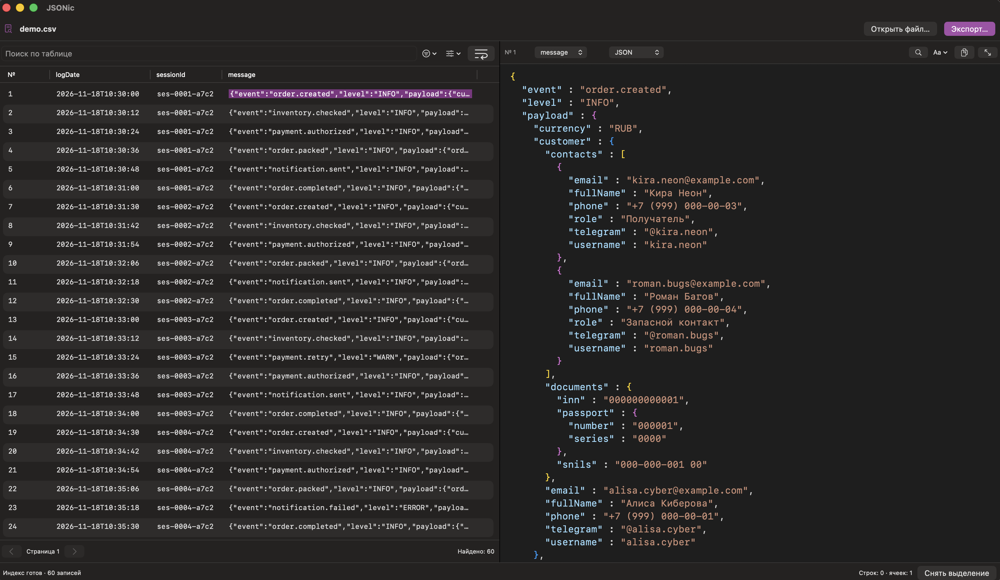
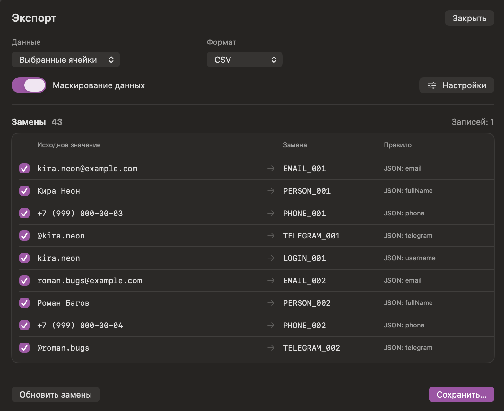

# JSONic

Приложение для macOS: просмотр CSV и Excel, быстрый поиск по логам и разбор JSON внутри ячеек. Всё обрабатывается локально, без отправки файлов на сервер.

## Возможности

- CSV, TSV, XLS и XLSX с выбором листа.
- Поиск по таблице и внутри ячейки; JSON с подсветкой и в виде дерева.
- Редактирование ячеек без изменения исходного файла.
- Экспорт таблицы, результатов поиска или выделения в CSV; одной ячейки — в JSON/TXT.
- Маскирование чувствительных данных с предпросмотром замен.

## Интерфейс

Просмотр таблицы и вложенного JSON на синтетических данных.

Предпросмотр маскирования: 43 замены в одной выбранной ячейке.

## Установка

**macOS 13 Ventura или новее · Apple Silicon и Intel.**

1. Скачайте **DMG** в разделе [Releases](../../releases).
2. Откройте его и перетащите **JSONic** в **Программы**.
3. Запустите приложение из папки «Программы».

Приложение не нотарифицировано Apple. Если macOS блокирует запуск: после попытки открытия перейдите в **Системные настройки → Конфиденциальность и безопасность → Всё равно открыть**, затем подтвердите запуск.

Для знакомства откройте [demo.csv](Examples/demo.csv): 60 синтетических событий интернет-магазина с вложенным JSON и примерами для маскирования. Перед передачей экспорта проверьте замены: автоматическое маскирование может пропустить чувствительные данные. Правки сохраняются через экспорт копии.

## Технологии

Swift · SwiftUI · AppKit · SQLite FTS5 · libxls · ZIPFoundation.

[Сборка и устройство проекта](docs/DEVELOPMENT.md) · [Сторонние компоненты и лицензии](ThirdParty/SOURCES.md)

## Лицензия

[MIT](LICENSE) © 2026 rs-an. Сторонние компоненты сохраняют [свои лицензии](ThirdParty/SOURCES.md).
