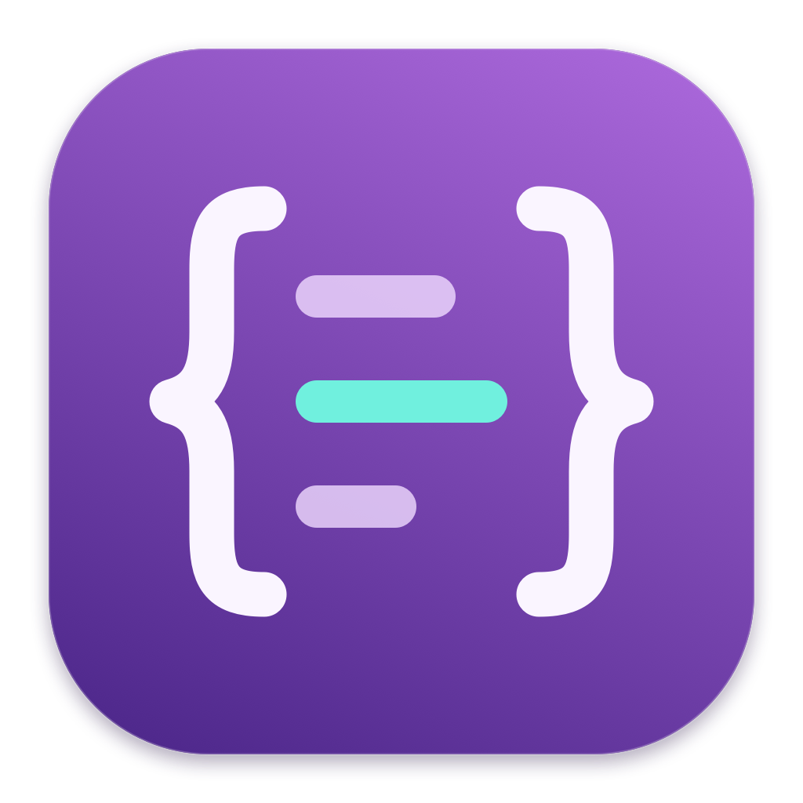

# JSONic

A native macOS app for viewing CSV and Excel files, searching logs, and exploring JSON inside cells. All processing happens locally; your files are never uploaded to a server.

## Features

- Open CSV, TSV, XLS, and XLSX files, with sheet selection for Excel workbooks.
- Search tables and individual cells; explore JSON with syntax highlighting and a tree view.
- Edit cells without modifying the original file.
- Export a table, search results, or a selection to CSV; export a single cell to JSON or TXT.
- Mask sensitive data and preview replacements before exporting.

Masking scans cell contents and nested JSON values for recognizable patterns such as email addresses, regardless of the header.

Masking recognizes English and Russian field names in table columns and JSON. Email and IP detection is language-independent; logins and secrets are detected through recognized fields or explicit labels. Free-text name and address detection focuses on Russian, phone detection on `+7`/`8` formats, and document detection on Russian INN, SNILS, and passports. General English free-text name and address recognition is not supported.

## Screenshots

Explore a table and nested JSON using synthetic sample data.

Preview masking results: 43 replacements in a single selected cell.

## Installation

**macOS 13 Ventura or later · Apple Silicon and Intel.**

1. Download the **DMG** from [Releases](../../releases).
2. Open it and drag **JSONic** to **Applications**.
3. Launch the app from Applications.

The app is not notarized by Apple. If macOS blocks it, try opening it first, then go to **System Settings → Privacy & Security → Open Anyway** and confirm.

To try it out, open [demo.csv](Examples/demo.csv): 60 synthetic online store events with nested JSON and examples for masking. Review replacements before sharing an export: automatic masking may miss sensitive data. Save your edits by exporting a copy.

## Built With

Swift · SwiftUI · AppKit · SQLite FTS5 · libxls · ZIPFoundation.

[Build instructions and project structure](docs/DEVELOPMENT.md) · [Third-party components and licenses](ThirdParty/SOURCES.md)

## License

[MIT](LICENSE) © 2026 rs-an. Third-party components retain [their respective licenses](ThirdParty/SOURCES.md).
